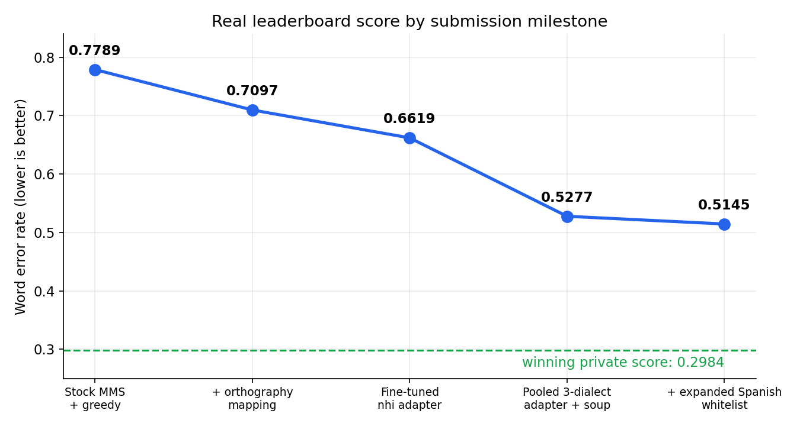
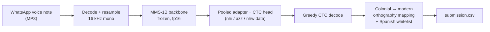
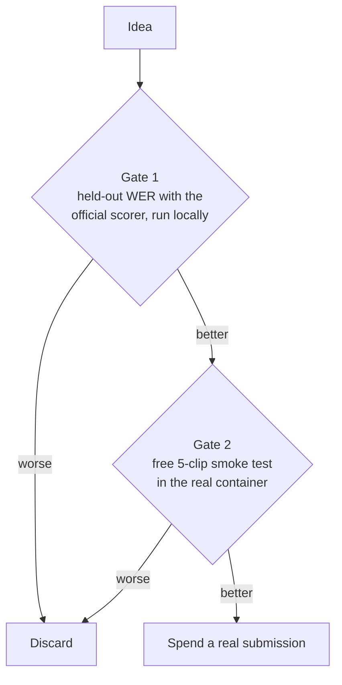
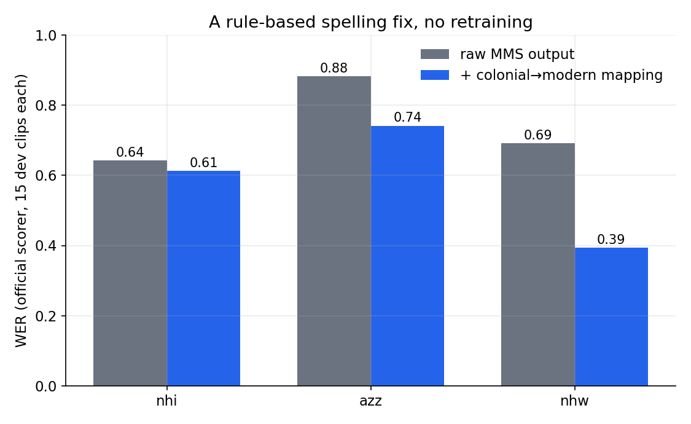
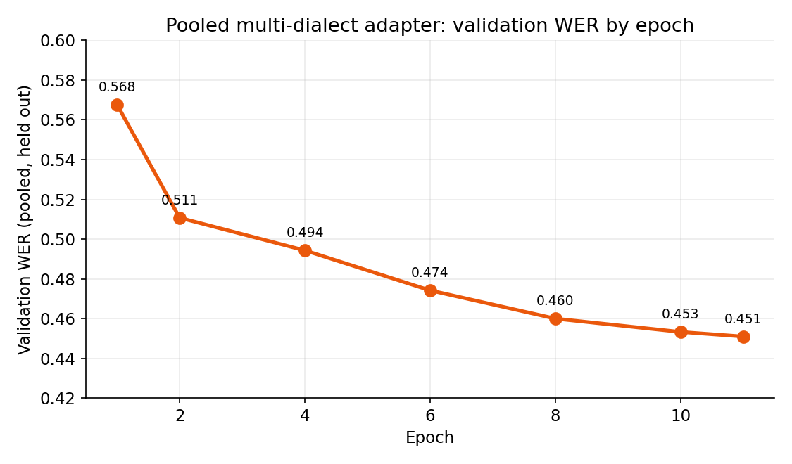
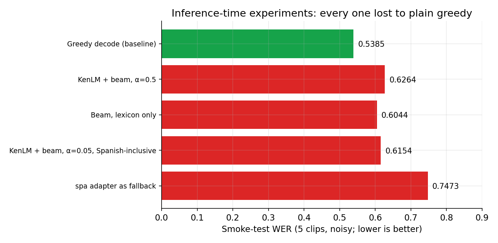

# Lost in Transcription: Spanish–Nahuatl ASR


Speech recognition for conversational, code-switched **Spanish–Nahuatl** voice notes, built for the
DrivenData × Mozilla Data Collective "Lost in Transcription" challenge
([organizers' public runtime repo](https://github.com/drivendataorg/lost-in-transcription-runtime)).

I did not win. I finished **#40 at 0.5145 WER**; the winning private score was **0.2984**.
This repo is the honest engineering record: what moved the score, what didn't, and what I'd do differently.

---

## Result at a glance

| | WER (lower is better) |
|---|---|
| First real submission (stock MMS, greedy decoding) | **0.7789** |
| Final submission | **0.5145** |
| Absolute improvement | −0.264 |
| Relative improvement | **−34%** |
| Winning private score | 0.2984 |
| Remaining gap to the winner | 0.216 |



| # | Milestone | Real WER |
|---|---|---|
| 1 | Stock MMS-1B adapters, greedy CTC decoding | 0.7789 |
| 2 | Colonial → modern orthography mapping added (two submissions scored identically) | 0.7097 |
| 3 | Fine-tuned `nhi` adapter (published recipe) + mapping | 0.6619 |
| 4 | **Pooled 3-dialect adapter + checkpoint averaging** | 0.5277 |
| 5 | Expanded Spanish-loanword whitelist (23 → ~200 words) | **0.5145** |

---

## The problem

- **Task:** transcribe spontaneous WhatsApp-style voice notes mixing Spanish with Nahuatl.
- **Data:** a ~3.4 h, 5-speaker Nahuatl corpus (Tetelancingo / Western Sierra Puebla, `nhi`; [Pugh et al., NAACL 2025](https://aclanthology.org/2025.naacl-long.181.pdf)) plus a small 1.3 h development set spanning three
  varieties: Highland Puebla (`azz`), Western Huasteca (`nhw`) and `nhi`.
- **Metric:** word error rate, scored by the organizers' own normalizer.
- **Constraints that shaped everything:** code-execution container, no network access, bundled weights only,
  no hosted APIs, every test clip processed independently, strict logging rules.

## System overview



Only ~2.2M parameters (the adapter layers and the 40-token CTC head) were trained. The 1B-parameter backbone stayed frozen.

## How I decided what to trust: two gates

Submissions were scarce, so every idea had to clear two cheap checks before it could use one.



This killed a lot of plausible-sounding ideas cheaply. It also had a limit I learned the hard way: the 5-clip
smoke test predicted the **direction** of a change, not its **size** (0.4945 smoke → 0.6619 real; 0.3297 smoke → 0.5277 real).

---

## What moved the score

### 1. Orthography mapping: a rule-based fix, no retraining

Stock MMS decodes Nahuatl in colonial, Spanish-influenced spelling (`qu`, `c`, `hu`, `z`). The competition's
references use modern conventions (`k`, `u`, `s`). Most Nahuatl words contain one of those sounds, so the model could be
phonetically right and still be scored wrong on nearly every word. (Per the corpus paper, MMS's `nhi` training data is an
audio Bible written in the San Miguel Tenango orthography, which spells /k/ as `c`/`qu`.)



| Dialect | Raw | + mapping | Change |
|---|---|---|---|
| `nhi` | 0.6427 | 0.6129 | −0.030 |
| `azz` | 0.8829 | 0.7415 | −0.142 |
| `nhw` | 0.6917 | 0.3941 | −0.298 |

*Stock MMS adapters, official scorer, 15 dev clips per dialect (small samples, so treat as indicative).*

The same rules also mangle Spanish words (`cinco` → `cinko`), so a whitelist protects Spanish loanwords. Growing it
from 23 to ~200 verified words was worth about **0.013 WER** on the final leaderboard (0.5277 → 0.5145).

### 2. Fine-tuning adapters the way the literature does it

My first fine-tune made things worse: I rebuilt a custom 60-token vocabulary and replaced the pretrained output head
with a fresh one. It scored **0.75 vs 0.67 for stock** on a 25-clip benchmark.

The corpus paper (Pugh, Wing, Juárez Huerta, Márquez Hernández & Tyers, *"Ihquin tlahtouah in Tetelahtzincocah"*,
NAACL 2025, pp. 3549–3562) reports the opposite outcome for
adapter fine-tuning on the same data: roughly **0.71 → 0.38 WER** in their same-corpus split, and about **0.42** on held-out speakers.
Their setup was simpler than mine: keep the stock vocabulary and the pretrained head, tune only the adapter,
and train for many more epochs.

Redoing it that way produced a held-out validation WER of about 0.45, and **0.5184 vs 0.6129** (stock) on a 25-clip dev benchmark.
That adapter scored **0.6619** on the real leaderboard.

### 3. One adapter for all three dialects, plus checkpoint averaging

The track evaluates across regional varieties without giving dialect-level labels (`nhi`, `azz` or `nhw`) at
inference time, so one adapter has to serve everything. An `nhi`-only adapter collapses on Puebla and Huasteca speech.

I trained a **pooled adapter** on the large `nhi` corpus plus the small `azz`/`nhw` dev data, with the small dialects
oversampled (50 / 25 / 25 split). The run hit Kaggle's 12-hour limit at epoch 11 of 16, still improving.



Averaging the epoch-10 and epoch-11 checkpoints ("model soup", two minutes on CPU, no training) gave small, consistent gains:

| Dialect | Held-out clips | WER, single checkpoint | WER, averaged |
|---|---|---|---|
| `nhi` | 537 | 0.4537 | 0.4558 |
| `azz` | 74 | 0.5335 | 0.5290 |
| `nhw` | 24 | 0.2642 | 0.2569 |

> **Caveat.** These local numbers are optimistic. The references were cleaned down to the model's vocabulary first, the
> `azz`/`nhw` slices are tiny, and they are not guaranteed to be speaker-disjoint from training. Use them to compare
> variants, not as leaderboard predictions. The honest number is the real one: **0.5277**.

**Why not just average Meta's stock `nhi`/`azz`/`nhw` adapters?** Their output heads use different vocabularies
(36 tokens for `azz` vs 40 for `nhi`), so they can't be blended into one head, and independently trained bottleneck
layers have no guaranteed alignment. Checkpoints along a single fine-tuning run don't have either problem, which is
why the soup averaged epochs 10 and 11 of one run.

This was the biggest single gain after the orthography fix: **0.6619 → 0.5277**.

---

## What didn't work



| Experiment | Outcome | Verdict |
|---|---|---|
| Whisper-small, zero-shot, forced to Spanish | WER 0.94 / 1.02 / 1.21 (`nhi`/`azz`/`nhw`) | No Nahuatl exposure; dropped |
| First fine-tune (custom vocab, new head) | 0.75 vs stock 0.67 | Worse than doing nothing |
| KenLM n-gram + `pyctcdecode` beam search (3 configurations) | smoke 0.60–0.63 vs greedy 0.54 | Worse every time |
| Lexicon-free CTC prefix beam search | 0.7488 vs greedy 0.7338 (local) | Worse |
| Blank-token logit bias sweep (±4) | Zero bias was best on all three dialects | No headroom |
| Single-utterance test-time adaptation (SUTA) | No accuracy change, ~83 s per clip | Too slow and no gain |
| `spa` adapter as the code-switch fallback | smoke 0.7473 vs 0.5385 | Worse |
| Continuation training + WhatsApp-style augmentation + 55% `azz` oversampling | `nhi` 0.50→0.60, `nhw` 0.39→0.65, `azz` 0.74→0.84 | Regressed; discarded |

Ideas I reasoned out rather than ran: loudness normalization (the feature extractor already normalizes every
utterance) and temperature scaling (it can't change a greedy `argmax`, so it does nothing here).

---

## Engineering lessons

- **Read the scorer's source.** My local WER used a loose approximation that lowercased everything. The real scorer
  only lowercases sentence-initial letters and keeps accents. The organizers' public runtime repo has the exact code;
  I should have used it from day one. I also audited the dev references: only 64 of 7,795 words (0.82%) carry
  mid-sentence capitals, which caps that penalty near 0.008 WER, so I skipped building a truecasing pass.
- **Silent failure is the worst failure.** A single unmapped language tag threw a lookup error that my per-clip
  `try/except` turned into empty strings, so a whole run scored as 5/5 blank predictions. Fix: log the first
  exception and a count of empty outputs (never transcript content).
- **Respect the logging rules while still debugging.** To learn which language tags the test manifest used, I logged
  the first occurrence of each tag, never counts.
- **Air-gapped containers change your toolbox.** Weights are bundled, dependencies are whatever is pre-installed
  (no compiled extensions you bring yourself), so converting weights to fp16 halved the archive to ~1.9 GB.
- **Adapter loading gotcha (transformers 4.57):** `from_pretrained(target_lang=...)` did not reliably load the
  adapter weights; an explicit `load_adapter(...)` call was needed.
- **Change one variable at a time.** My last continuation run changed two things at once (a harsh low-pass filter and
  heavy oversampling), so when it regressed I couldn't say which one caused it.

## What the leaders probably did differently

Pure speculation: nobody on the board shared their work. The top private scores sat around **0.30–0.32**, roughly
0.2 WER ahead of this pipeline. That gap is more consistent with a structural difference (more of the backbone
tuned with proper regularization, more or better data, stronger rescoring) than with more polishing of an
adapter-only pipeline. My own evidence says adapter-only training on this data was exhausted: further gradient steps
overfit the ~100-clip dialect pools every time.

## What I'd do differently

1. **Start from the published recipe immediately** (stock vocabulary, pretrained head, adapter-only, long training) instead of rebuilding the vocabulary first.
2. **Build a trustworthy local evaluation first:** the official scorer, raw references, speaker-disjoint splits.
3. **Isolate variables** in every experiment.
4. **Test the channel mismatch cleanly.** The training audio was clean WAV and the test audio is compressed WhatsApp audio. I flagged this early and never ran a clean test of codec-style augmentation on its own.
5. **Spend a real submission earlier** to calibrate how well the free smoke test predicts the real score.

---

## Repository layout

```text
.
├── README.md
├── LICENSE                  # MPL-2.0
├── score.py                 # copy of the organizers' public scorer (run scripts from the repo root)
├── package_submission.py    # zips src/ for upload
├── src/
│   ├── main.py              # container entrypoint: manifest in, submission.csv out
│   ├── asr_model.py         # model loading, adapter routing, greedy decoding
│   ├── audio_io.py          # decode + resample (soundfile first, torchaudio fallback)
│   └── orthography.py       # colonial → modern mapping + Spanish whitelist
├── scripts/                 # the pipeline that produced the final score
│   ├── download_mms_weights.py
│   ├── convert_weights_fp16.py
│   ├── finetune_nhi_adapter_v3.py        # adapter recipe from the corpus paper
│   ├── finetune_pooled_adapter.py        # pooled 3-dialect training (Kaggle)
│   ├── model_soup_average_checkpoints.py
│   ├── eval_gate1_nhi.py
│   ├── eval_pooled_per_dialect.py
│   ├── verify_mapping_with_real_scorer.py
│   └── analyze_orthography_diffs.py
├── experiments/             # negative results, kept for the record
│   ├── finetune_nhi_adapter.py           # first attempt: custom vocab + new head
│   ├── compare_whisper_zeroshot.py
│   ├── pure_ctc_beam_eval.py
│   ├── suta_eval.py
│   ├── test_blank_bias_local.py
│   └── prepare_lm_corpus.py              # KenLM experiment
└── assets/                  # charts used in this README
```

Run everything from the repository root (the scripts use paths like `data/...` and `src/...`).

**Not included, on purpose:** audio, transcripts, dataset files and model weights.

## Reproducing

1. Get the datasets from the competition's Mozilla Data Collective pages and place them under `data/`.
2. Download `facebook/mms-1b-all` locally; keep only the adapters you need (`nhi`, `azz`, `nhw`) and convert to fp16.
3. Train with `scripts/finetune_pooled_adapter.py` (a Kaggle GPU notebook worked), then average the last two checkpoints.
4. Put the resulting adapter at `src/weights/mms-1b-all/adapter.nhi.safetensors`.
5. `python package_submission.py` builds the archive. Files sit at the zip root; the runtime unpacks into `src/` itself.

## Licenses, data and acknowledgements

- **Code:** MPL-2.0 (the competition's required license for winning solutions; kept here for consistency).
- **Model weights:** not redistributed. MMS is released by Meta under its own license; check the model card before any
  commercial use.
- **Data:** follow the license terms on the Mozilla Data Collective dataset pages. No competition audio or transcripts are included here.
- Thanks to DrivenData and the Mozilla Data Collective for running the challenge, to the authors of the Tetelancingo
  corpus paper (*"Ihquin tlahtouah in Tetelahtzincocah"*, NAACL 2025), and to the open-source stack:
  Meta MMS, Hugging Face Transformers, `pyctcdecode`, KenLM and `jiwer`.
